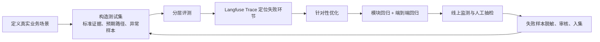

# RAG / Agent 评测与优化闭环

> 适用于公共雨伞 AI 客服与人工协同系统，以及基于 OpenClaw 的后台自动化与智能数字人系统。本文描述评测方案与面试表达，不代表已经取得具体线上指标；没有实测数据时，不将目标值表述为项目成果。

## 一、主链路

```text
真实业务场景
  -> 构造带预期结果的测试集
  -> 分层评测 RAG / Skill / Workflow / 工具 / 端到端
  -> 用 Trace 定位失败环节
  -> 针对该环节优化
  -> 回归验证
  -> 线上监测、抽检并补充失败样本
  -> 回到测试集，持续迭代
```

**先定位，再优化；每次优化后跑回归；线上失败样本脱敏、审核后沉淀为新用例。**

## 二、流程图



## 三、各层评测与优化

| 层级 | 评测重点 | 典型问题 | 优化方向 |
|---|---|---|---|
| RAG 检索 | 正确证据、规则版本是否进入 Top-K；无关和过期内容是否排除 | 召回遗漏、旧规则混入、噪声过多 | 修正文档清洗与切片；补 metadata 和生效状态；改查询改写、混合检索、候选数量与 Reranker |
| RAG 生成 | 答案是否忠于证据；引用能否支持结论；证据不足是否拒答或转人工 | 检索正确但回答错、引用不支持、无依据补全 | 检查上下文组织和冲突；明确引用格式与回答边界；加入拒答、澄清和人工复核条件 |
| Skill | 是否该触发时触发、不该触发时不触发；缺参是否追问；任务和输出是否合格 | 误触发、漏触发、猜参数、执行不完整 | 精炼触发和排除条件；定义输入输出契约；补充追问、失败处理和边界示例 |
| Agent Workflow | 意图路由、节点顺序、状态转换、重试、中断恢复是否符合预期 | 走错分支、错误状态继续、重复重试或未恢复 | 用 Trace 定位节点；明确状态和转换条件；补齐错误分类、停止条件、重试及人工接管分支 |
| 业务工具 | 参数、权限、返回结构、超时、幂等和副作用是否受控 | 参数错误、越权、重复写入、超时后状态不明 | 服务端契约与业务校验；执行端鉴权；写操作幂等；区分可重试错误；高风险操作增加审批 |
| 端到端结果 | 问题是否解决；是否使用正确知识和实时数据；转人工是否恰当 | 单项通过但业务失败；转人工过多或不足 | 回放完整任务；检查知识、实时工具和流程交接；调整追问与接管条件并补场景用例 |
| 安全治理 | 越权、敏感信息泄露、高风险误执行是否被拦截 | 注入绕过、权限泄露、未审批写操作 | 服务端鉴权；检索前过滤并隔离缓存；敏感信息脱敏；高风险操作审批；加入对抗回归集 |

## 四、测试集设计

按真实业务意图分组，例如借伞失败、还伞后仍计费、押金退款、设备离线、活动规则咨询。每条用例记录：

- 用户输入与必要上下文；
- 预期意图、标准证据及规则版本；
- 预期工具或工作流路径；
- 答案必须包含和禁止推断的内容；
- 是否应该追问、拒答或转人工；
- 风险等级和通过条件。

每项能力覆盖正常、边界、异常三类。例如 Skill 同时测试“应触发”和“相似但不应触发”；工具覆盖权限不足、空结果、超时和重复请求；安全测试覆盖提示注入和越权请求。

## 五、Langfuse 如何辅助定位

一次用户请求记录为 Trace；意图识别、检索、模型调用、Skill/工具执行、人工交接等记录为 Span/Observation。记录必要的输入输出、模型与 Prompt 版本、检索文档 ID/版本、耗时、token、错误和重试；敏感内容应脱敏或不采集。

发现问题后，沿 Trace 找最早出现偏差的步骤：检索证据错，优化检索；证据正确但回答错，优化上下文和生成约束；Skill 或路由错，优化触发条件和流程；工具结果或副作用异常，优化服务端契约、鉴权和幂等；各步骤局部正确但业务未解决，回到端到端场景与人工协同设计。

Langfuse 用于观测、追踪和辅助定位，不自动证明答案正确，也不能代替带标准答案的离线评测和人工抽检。

## 六、2–3 分钟面试逐字稿

> 我们做 AI 应用评测时，不会只看最后一句回答像不像正确，而是按真实业务链路分层评测，再把发现的问题定位到具体环节。
>
> 第一步是定义业务场景。以公共雨伞客服为例，我们会覆盖借伞失败、还伞后仍计费、押金退款、设备离线和活动规则咨询。每条用例会标明预期意图、正确的知识证据和规则版本、应该走的工具或流程，以及什么时候需要追问或转人工。然后把这些标准整理成测试集，同时覆盖正常、边界和异常情况。
>
> 第二步是分层评测。RAG 检索看正确证据和版本有没有召回；RAG 生成看答案是否忠于证据、引用能不能支持结论，以及没证据时会不会拒答。Skill 看是否正确触发、缺参数时是否追问、任务是否按约定完成。Agent 工作流看意图路由、节点状态、重试和中断恢复。业务工具则重点测参数校验、服务端权限、超时、幂等和副作用。最后再跑端到端用例，判断业务问题是否真正解决、转人工是否合适，并单独检查越权和高风险操作。
>
> 第三步是定位和优化。我们可以用 Langfuse 把一次请求记录成 Trace，把检索、模型调用、工具执行等作为步骤，查看每一步的输入输出、耗时和错误。如果检索证据错，就优化切片、metadata 或混合检索；如果证据正确但答案错，就调整上下文和生成约束；如果工具重复执行或权限不对，就加强服务端校验、幂等和审批。关键是不要只凭最终答案猜原因，而要找最早发生偏差的环节。
>
> 修复后，我会把失败样本加入回归集，先跑对应模块，再跑完整业务链路，确认没有造成其他场景退化。上线后再通过 Trace、人工抽检和用户反馈发现新问题，把脱敏并审核过的样本继续补进测试集。这样形成从场景、评测、定位、优化到回归和线上反馈的闭环。至于解决率、转人工率等指标，要基于真实测试或线上数据统计，没有数据时不会把目标说成已经取得的成果。

## 七、面试记忆口诀

**场景建集、分层评测、Trace 定位、按层优化、回归验证、线上回流。**
